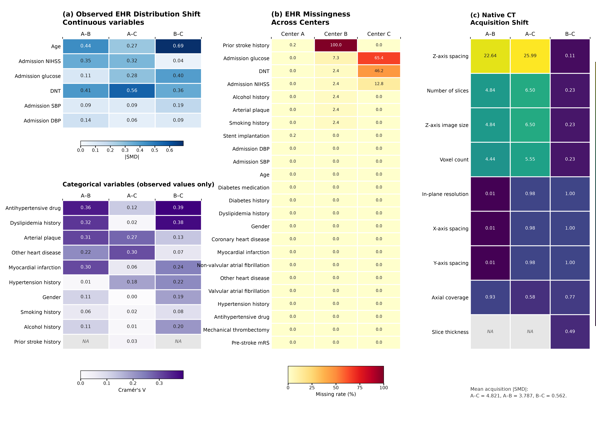
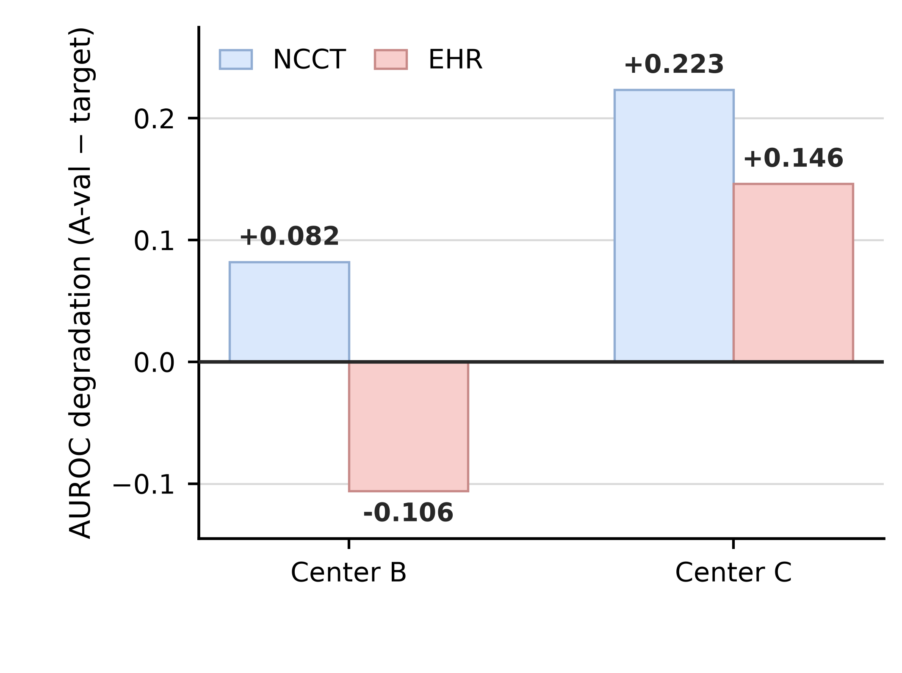
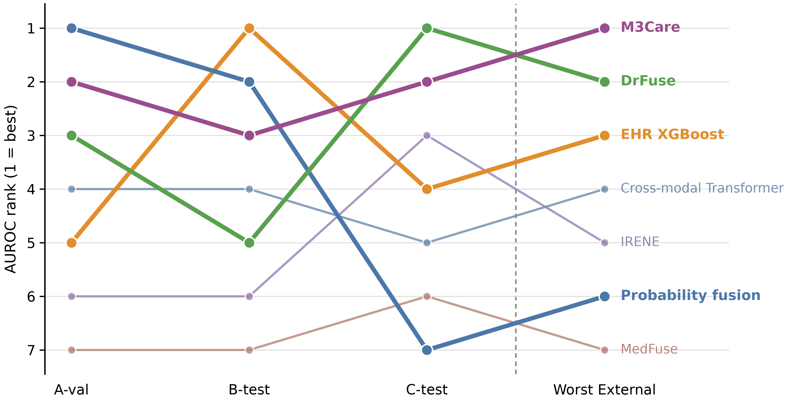
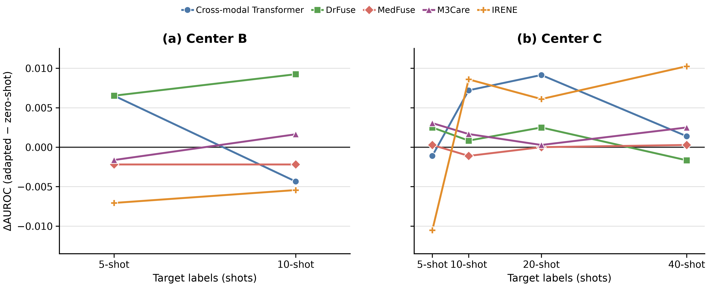

# StrokeShift

**How robust is multimodal clinical data integration across institutions?**

StrokeShift is a multi-institutional benchmark for studying cross-institution
generalization in post-thrombolysis hemorrhagic transformation (HT) prediction.
It pairs pre-treatment non-contrast head CT (NCCT) with structured electronic
health record (EHR) variables and evaluates whether performance selected at one
institution transfers to independent external centers.

> **Release status.** This repository contains code, configurations, aggregate
> results, and publication figures. The processed benchmark data are distributed
> separately under the applicable data-access process.

---

## At a glance

| Item | Frozen benchmark |
|---|---|
| Clinical task | Predict post-thrombolysis HT from pre-treatment NCCT + structured EHR |
| Cohort | 599 patients across three institutions |
| Source center | Center A: 384 train + 96 validation cases |
| External centers | Center B: 41 cases; Center C: 78 cases |
| Outcome prevalence | 273 HT / 326 non-HT |
| NCCT representation | Processed 128 × 128 × 128, 1-mm isotropic volumes |
| Structured EHR inputs | 24 pre-treatment variables |
| Frozen random seeds | 20260925, 20260926, 20260927, 20260928, 20260929 |

### Cohort and evaluation design

```text
                    Center A (source, n = 480)
                  ┌──────────────┴──────────────┐
          A_train (n = 384)              A_val (n = 96)
          model fitting                  source selection only

Center B (n = 41) ──────────────────────► external evaluation only
Center C (n = 78) ──────────────────────► external evaluation only
```

Centers B and C are never used for source model selection, early stopping,
threshold selection, calibration, or split changes.

---

## Why StrokeShift?

Multimodal models are commonly selected using source-center validation scores.
StrokeShift tests whether that selection strategy remains reliable when both
clinical documentation and CT acquisition characteristics change across
institutions. The benchmark distinguishes:

- source-center discrimination from external discrimination;
- observed EHR distribution shift from EHR missingness shift;
- synthetic corruption robustness from real institutional robustness; and
- descriptive few-shot trajectories from statistically supported recovery.

## Clinical task and data modalities

The primary outcome is **post-thrombolysis hemorrhagic transformation (HT)**.

| Modality | Release representation | Examples |
|---|---|---|
| NCCT | Preprocessed 3D NIfTI volume | 128³, 1-mm isotropic, normalized intensity |
| Structured EHR | 24 pre-treatment variables | Age, admission NIHSS, blood pressure, glucose, vascular/medication history |
| Native acquisition metadata | De-identified metadata only; native volumes are not released | Spacing, slice count, axial coverage, voxel count |

The data release excludes native CT volumes, direct identifiers, internal
linkage fields, and post-treatment leakage fields.

---

## Research questions

| RQ | Question | Main artifact |
|---|---|---|
| RQ1 | How do EHR distributions, missingness, and CT acquisition differ across centers? | Cross-center heterogeneity analysis |
| RQ2 | How do NCCT-only and EHR-only models transfer externally? | Unimodal performance and degradation summaries |
| RQ3 | Does multimodal fusion provide stable external robustness? | Multimodal evaluation and paired comparisons |
| RQ4 | Can missingness or data-quality degradation explain the generalization gap? | EHR/CT corruption analyses |
| RQ5 | Can a small number of target-center labels repair external discrimination? | Fixed-query few-shot adaptation study |
| RQ6 | Which findings are stable across research questions? | Cross-RQ synthesis |

---

## Selected frozen analyses

### RQ1 — cross-center heterogeneity

Observed clinical distributions, missingness, and native NCCT acquisition
characteristics differ across centers. Effect-size definitions remain separate:
continuous EHR variables use absolute SMD, categorical variables use Cramér’s V
after excluding missing values, and CT acquisition variables use absolute SMD.

<p align="center">
  
</p>

### RQ2 — modality-level transfer differs by target center

Degradation is defined as source validation AUROC minus target-center AUROC,
averaged across the four models within each modality. Center B shows different
average behavior for NCCT and EHR, whereas both modalities degrade on Center C.

<p align="center">
  
</p>

### RQ3 — source ranking is not a proxy for external robustness

Ranking trajectories show that a model selected on A-val does not necessarily
remain top-ranked at B-test, C-test, or under worst-external evaluation.

<p align="center">
  
</p>

### RQ5 — few-shot target adaptation does not yield stable AUROC recovery

This figure reports five-seed mean changes in AUROC relative to matched-query
zero-shot evaluation. Trajectories are small, center-specific, and non-monotonic
with additional support labels; they are not stable recovery claims.

<p align="center">
  
</p>

All displayed figures use frozen aggregate outputs already included here. They
do not introduce new training, inference, or statistical tests.

---

## Models

| Family | Methods |
|---|---|
| NCCT-only | SimpleCNN, ResNet18, DenseNet121, Swin Transformer |
| EHR-only | Logistic Regression, Random Forest, XGBoost, MLP |
| Multimodal | Probability fusion, Cross-modal Transformer, MedFuse, M3Care, DrFuse, IRENE |

The RQ3 SOTA extension adapts relevant core architectures to 3D NCCT and
structured EHR. The IRENE adaptation retains 3D image tokenization, clinical
tokens, intramodal attention, bidirectional intermodal attention, two
multimodal diagnostic transformer blocks, and the subsequent self-attention
stack.

## Evaluation protocol

Metrics include AUROC, AUPRC, F1, sensitivity, specificity, Brier score, and
expected calibration error (ECE). See [the full protocol](docs/evaluation_protocol.md).

| Target center | Support sizes | Fixed query set | Adaptation rule |
|---|---:|---:|---|
| B | 5, 10 | 31 | Deep models adapt terminal heads only; calibration methods use support-only Platt calibration |
| C | 5, 10, 20, 40 | 38 | Same frozen source model and support-only adaptation rule |

For deep models, the source backbone is frozen and the terminal head is adapted
with AdamW (learning rate 1e-3, weight decay 1e-4, batch size 2) for exactly
25 updates. Query labels are evaluation-only.

---

## Repository layout

```text
StrokeShift_Code_GitHub/
├── configs/        # Frozen experiment recipes and model configurations
├── docs/           # Benchmark, data-format, protocol, and reproducibility notes
├── figures/        # Publication figures and their plotting scripts
├── results/        # Non-sensitive aggregate tables for RQ1–RQ5
├── scripts/        # Analysis scripts organized by research question
├── src/models/     # 3D adaptations for selected multimodal models
├── requirements.txt
└── environment.yml
```

## Installation

```bash
conda env create -f environment.yml
conda activate strokeshift
export STROKESHIFT_DATA_ROOT=/path/to/StrokeShift_Data_Release
```

On Windows PowerShell:

```powershell
$env:STROKESHIFT_DATA_ROOT = 'C:\path\to\StrokeShift_Data_Release'
```

The code release is intentionally separated from patient-level data. Consult
[data_format.md](docs/data_format.md) before connecting a data release to a
script. Frozen analysis scripts and configurations are organized in
[`scripts/`](scripts/) and [`configs/`](configs/).

## Data access

The processed StrokeShift benchmark data are distributed separately:

`DATA_DOWNLOAD_LINK_TO_BE_ADDED`

The data package is intended for controlled research access under the applicable
institutional approval and data-use process. This repository does not assert
unrestricted public access to clinical data.

```text
StrokeShift_Data_Release/
├── processed_ncct/{A,B,C}/
├── ehr/ehr.csv
├── labels/labels.csv
├── splits/
├── metadata/
├── benchmark_manifest.csv
└── excluded_cases.csv
```

## Reproducibility scope

- Included: code, frozen configurations, aggregate results, plotting scripts,
  and publication figures.
- Excluded: patient-level EHR, labels, predictions, native CT, checkpoints,
  logs, and intermediate cache files.
- Third-party source trees are not redistributed; StrokeShift adaptations and
  associated experiment configurations are retained here.

See [reproducibility.md](docs/reproducibility.md) and
[benchmark.md](docs/benchmark.md) for release boundaries and cohort details.

## Ethics

This retrospective multi-institutional study was reviewed and approved by the
Ethics Committee of the Second Xiangya Hospital of Central South University
(approval No. **LYEC2026-0172**). See the data release documentation for the
full ethics statement and data-access conditions.

## Citation

Citation metadata will be finalized with the manuscript. Until then, please cite
the associated StrokeShift manuscript and identify this repository by its final
release version/commit.

```bibtex
@article{strokeshift2026,
  title   = {StrokeShift: How Robust Is Multimodal Clinical Data Integration Across Institutions?},
  author  = {To be completed},
  journal = {To be completed},
  year    = {2026}
}
```
